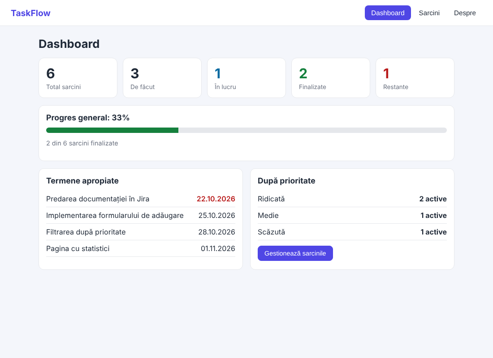
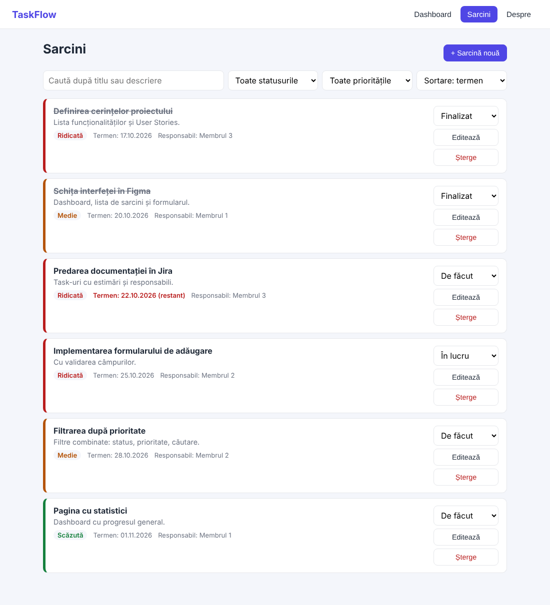
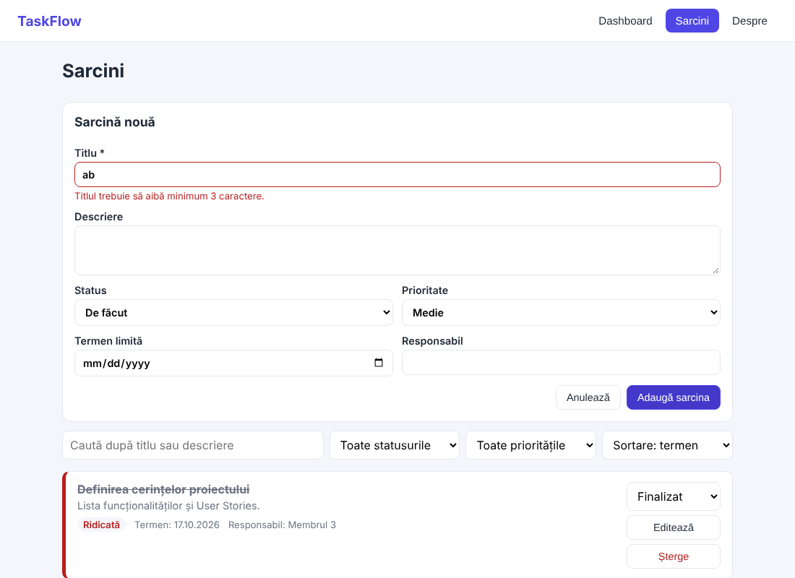
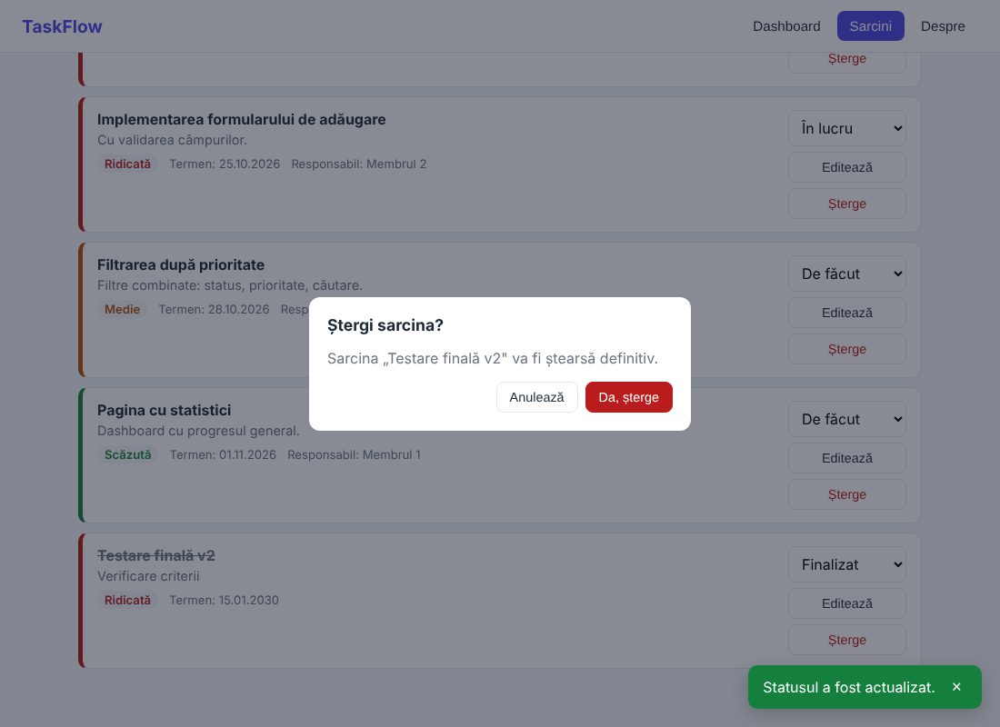
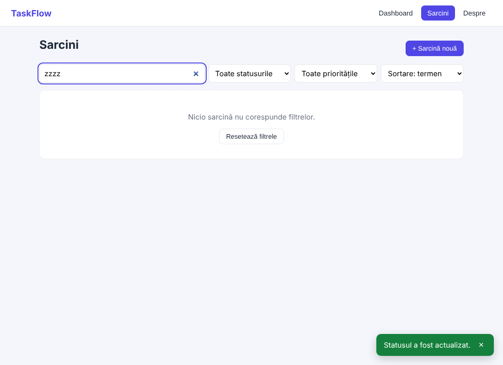
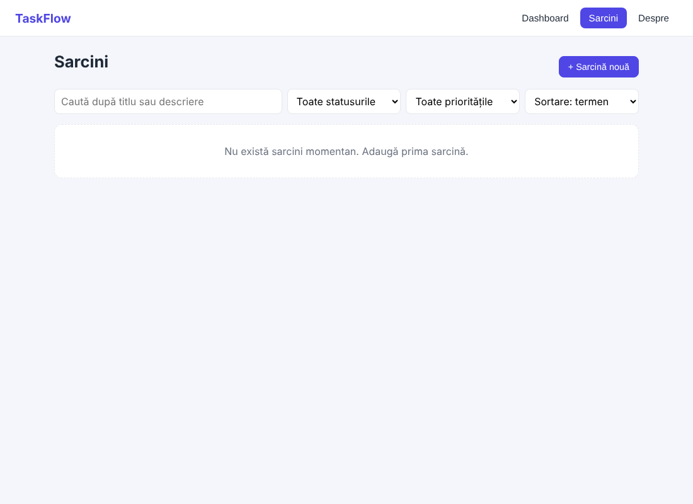
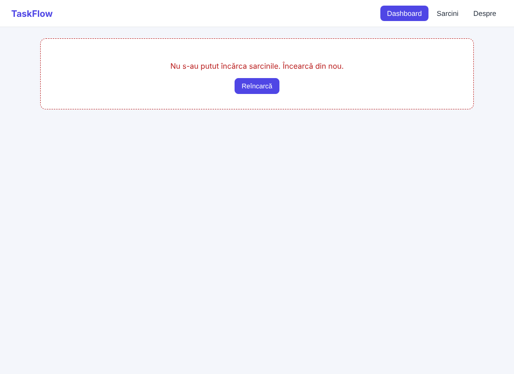
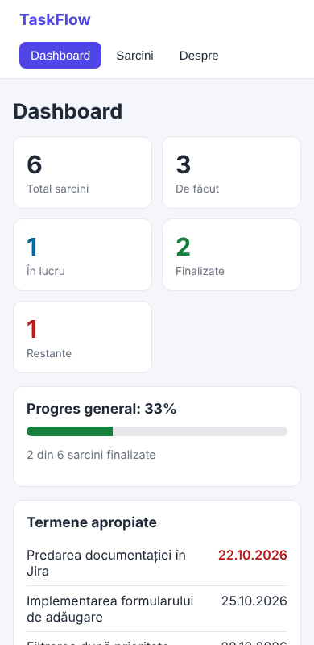

# TaskFlow — Studiu individual nr. 2

Aplicație web pentru gestionarea sarcinilor în echipă, realizată cu **React + Vite (JavaScript)**.
Permite organizarea sarcinilor, stabilirea termenelor-limită și urmărirea progresului printr-un dashboard.

## Echipa

| Membru | Rol orientativ | Responsabilități |
| --- | --- | --- |
| _[Nume Prenume]_ | Membrul 1 — UI și frontend | componente, navigare, formular, dashboard, aspect responsive |
| _[Nume Prenume]_ | Membrul 2 — Funcționalități și date | serviciul de date (CRUD), validare, filtrare, ștergere cu confirmare |
| _[Nume Prenume]_ | Membrul 3 — Integrare și calitate | configurarea proiectului, documentație, testare, Jira și GitHub |

## Funcționalități

- dashboard cu statistici: total, pe status, sarcini restante, progres, termene apropiate;
- navigare între 3 secțiuni: Dashboard, Sarcini, Despre;
- adăugare, editare și ștergere (cu confirmare) a sarcinilor;
- schimbarea statusului: De făcut / În lucru / Finalizat;
- căutare, filtrare după status și prioritate, sortare;
- validarea formularului (titlu obligatoriu, 3–80 caractere, descriere maximum 300);
- mesaje de succes și eroare, stări de încărcare, eroare și listă goală;
- datele rămân după reîncărcarea paginii; interfață adaptată pentru ecrane mici.

## Tehnologii

React 19, Vite, JavaScript (JSX), CSS, oxlint, Git/GitHub, Jira.

## Instalare și pornire

```bash
cd taskflow
npm install
npm run dev
```

Se deschide adresa afișată în terminal (de obicei `http://localhost:5173`).
Alte comenzi: `npm run build` (versiune de producție), `npm run lint` (analiza codului).

## Sursa de date și configurarea API-ului

Datele sunt gestionate de `src/services/taskService.js`, care expune funcții asincrone
(`getTasks`, `createTask`, `updateTask`, `deleteTask`) ca un API REST, dar păstrează datele în
localStorage. Nu este nevoie de configurare. La prima pornire se încarcă 6 sarcini de exemplu.
Pentru a conecta un API real (de exemplu json-server) se modifică doar acest fișier; componentele rămân neschimbate.

Pentru a reveni la datele de exemplu: DevTools → Application → Local Storage → șterge cheia `taskflow.tasks`.

## Structura proiectului

```
Studiu_individual_nr.2/
├── taskflow/            # aplicația React (src/components, pages, services, hooks, utils)
├── docs/                # documentația proiectului
│   ├── 01-fisa-proiect.md
│   ├── 02-user-stories.md
│   ├── 03-arhitectura-ui.md
│   ├── 04-jira-taskuri.md  (+ jira-import.csv)
│   ├── 05-testare.md
│   ├── 06-git-workflow.md
│   └── screenshots/
└── README.md
```

## Capturi de ecran

| Dashboard | Sarcini |
| --- | --- |
|  |  |

| Validarea formularului | Confirmarea ștergerii |
| --- | --- |
|  |  |

| Fără rezultate | Lista goală |
| --- | --- |
|  |  |

| Eroare la încărcare | Varianta mobilă |
| --- | --- |
|  |  |

## Documentație

- [Fișa proiectului](docs/01-fisa-proiect.md)
- [User Stories](docs/02-user-stories.md)
- [Arhitectură și schițe UI](docs/03-arhitectura-ui.md)
- [Task-uri Jira și estimări](docs/04-jira-taskuri.md)
- [Plan și rezultate de testare](docs/05-testare.md)
- [Git și GitHub](docs/06-git-workflow.md)
